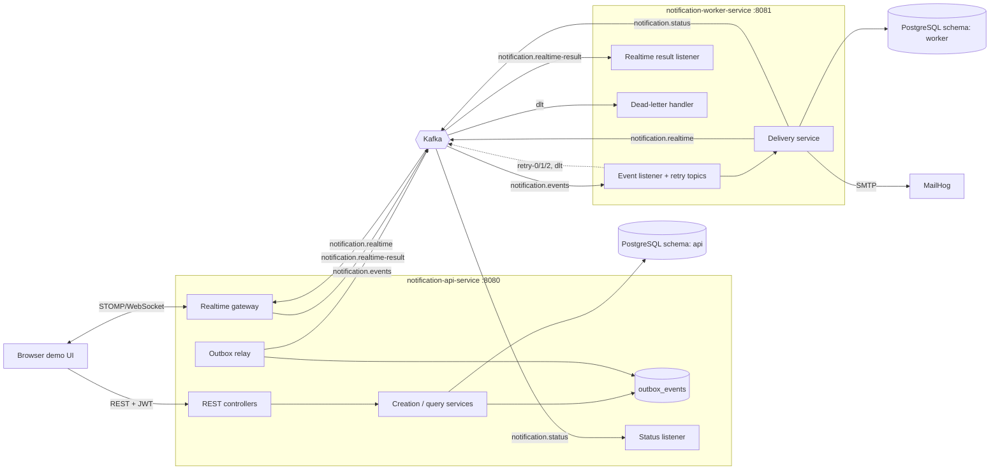

# Architecture

## Component diagram

## Service boundaries and why
* **api service** owns users, notifications, preferences, templates, outbox (schema `api`). Everything user-facing and the realtime gateway live here.
* **worker service** owns delivery records, attempts, dead letters (schema `worker`), with its own DB role. It never reads or writes `api` tables; it learns everything from the event and reports back through `notification.status`. *No shared tables.*
* **Realtime gateway inside api** (the brief allowed this). Pros: one WebSocket session registry next to authentication, fewer deployables. Cons: WebSocket load scales with the API; scale-out needs broadcast routing (see below). A split into `realtime-gateway-service` would only move `realtime/` and `messaging/RealtimeCommandListener` into its own module.
* Two services, not more: the second boundary (slow/failure-prone I/O: SMTP, retries) is the one that actually benefits from independent scaling and failure isolation.

## Kafka topics
| Topic | Producer | Consumer (group) | Key | Notes |
|---|---|---|---|---|
| `notification.events` | api outbox relay | worker (`notification-worker`) | recipientId | 3 partitions; per-recipient ordering |
| `notification.events-retry-0..N`, `-dlt` | worker (framework) | worker | recipientId | non-blocking retries, bounded by `worker.retry.attempts` |
| `notification.realtime` | worker | api gateway (`notification-api-realtime`) | recipientId | push command |
| `notification.realtime-result` | gateway (PUSHED/NO_ACTIVE_SESSION/ACKED) | worker (`notification-worker-results`) | notificationId | `.DLT` exists |
| `notification.status` | worker | api (`notification-api-status`) | notificationId | aggregated status; `.DLT` exists |

## Delivery guarantees (honest version)
* **At-most-once** = may lose, never duplicates. **At-least-once** = never loses (once accepted), may duplicate. **Exactly-once** = each effect exactly once; Kafka transactions give it inside Kafka only, not across PostgreSQL, SMTP and a browser.
* This system is **at-least-once with idempotent consumers**: the outbox republishes until Kafka acks; manual per-record offset commit after processing; `delivery_records` has a unique `(notification_id, channel)` so a duplicate event finds the channel already `SENT/DELIVERED` and does nothing. One residual window remains: if the worker crashes after SMTP accepted but before `SENT` is committed, the email may be sent twice. That cannot be eliminated without provider-side idempotency.
* **Logical duplicate prevention at the API:** `Idempotency-Key` + unique partial index `(created_by, recipient_id, idempotency_key)`. Concurrent duplicates: one insert wins, the loser catches the constraint violation and returns the winner's result (`200`, `duplicate:true`). The key is not bound to a payload hash (a production API would reject key reuse with a different body).

## Dual-write problem and the transactional outbox
Writing the notification to PostgreSQL and publishing to Kafka are two systems; no local transaction spans both. If we published first and the DB write failed we would announce something that doesn't exist; if the DB write succeeded and the publish failed we would silently lose the event.
**Implemented:** `NotificationPersistence.persist` saves the notification **and** an `outbox_events` row in one DB transaction. Kafka is touched only by `OutboxRelay` (polls every 500 ms): `SELECT … FOR UPDATE SKIP LOCKED` due rows, `send().get(timeout)` each, mark `PUBLISHED`. On failure: attempts++, exponential backoff (cap 60 s) stored in `next_attempt_at`, batch stops at the first failure to preserve order, after `max-attempts` the row is `FAILED` (alertable). If the app crashes between Kafka ack and commit, the row is republished → duplicate → handled by consumer idempotency. Polling was chosen over CDC (Debezium) because it needs no extra infrastructure; the cost is up to one poll interval of latency.

## Real-time delivery vs durable storage
WebSocket push reaches only *currently connected* sessions and is best-effort. The notification is **already committed** in PostgreSQL before anything is pushed. A client that was offline (or whose socket dropped) simply loads `GET /api/v1/notifications` after reconnecting; the demo UI does this on every (re)connect. The push is therefore a latency optimisation, not the source of truth.
In-app delivery states: `PROCESSING` (command handed to gateway) → `SENT` (gateway pushed it, or recipient had no live session and it is stored for later) → `DELIVERED` (browser sent `/app/ack`). A Kafka publish alone is never reported as delivery.

## State model
Notification **business state** (api): `read_at`, `archived_at`, and `delivery_status` (aggregate). **Channel delivery state** (worker): per channel `PENDING → PROCESSING → SENT → DELIVERED`, with `RETRYING` after a failed attempt and `DEAD_LETTERED` after exhaustion; `SUPPRESSED` is decided at creation when preferences remove every channel. `READ` is a user action (timestamp), not a delivery state; the API exposes it as `read:true`. Transitions are monotone via `status_updated_at` guards: the api ignores status events older than the stored one.

## Ordering and concurrency
Key = recipientId, so one recipient's events go to one partition and are consumed in order **by the main flow**. No global ordering. Retried events go to retry topics and can be overtaken by later events for the same recipient (accepted: notifications are independent). Optimistic locking (`@Version`) on notifications, preferences and delivery records; unique indexes enforce idempotency; bulk `markAllRead` is a single UPDATE.

## Security
JWT (HS256, secret from `JWT_SECRET`), `role` claim → `ROLE_*`. User id always comes from the token. Notification lookups are scoped by recipient id in SQL, so other users' ids return 404 (no existence leak). DTO whitelists + `fail-on-unknown-properties` stop mass assignment. STOMP: JWT in the CONNECT header (not the URL), `SUBSCRIBE` only to `/user/queue/notifications` (resolved per principal), `SEND` only to `/app/ack`, handshake origin allow-list. Rate limit per client address. Error bodies never include stack traces. Logs never contain tokens or message bodies; dead-letter rows keep the payload for replay (contains the recipient email): restrict DB access and add retention in production.

## Why no Redis
At this scale preferences are a primary-key lookup, the rate limiter is local, and idempotency is enforced by a database constraint, which is stronger than a cache-based check. Redis would add a component without removing a bottleneck. It becomes valuable for a shared rate limiter / presence registry when running several gateway instances.

## Scaling the gateway (known limitation)
With one consumer group on `notification.realtime`, only one gateway instance receives each command and it may not hold that user's socket. For multiple instances use a per-instance consumer group (broadcast) with each instance ignoring users it doesn't host, or route by user→instance. Local single-instance runs are unaffected.

## Production evolution
Debezium CDC instead of polling; separate gateway deployment behind a sticky/WebSocket-aware load balancer; replicated Kafka (RF=3, min.insync=2) and Postgres HA; per-channel topics; provider adapters (SES/SendGrid, FCM/APNs) behind the existing `EmailSender` port; OIDC with asymmetric keys; keyset pagination; archive/partition notification tables; OpenTelemetry tracing and Prometheus/Grafana alerting on consumer lag and `outbox_events` backlog.

## Extending: adding a template
Insert a row (new Flyway migration `V3__add_template.sql`): `INSERT INTO notification_templates (id, subject_template, body_template, category, mandatory) VALUES ('INVITE', 'You are invited, {{name}}', 'Join {{team}} today.', 'INFO', false);` Variables are discovered from `{{placeholders}}`; missing ones return `400` listing them.
