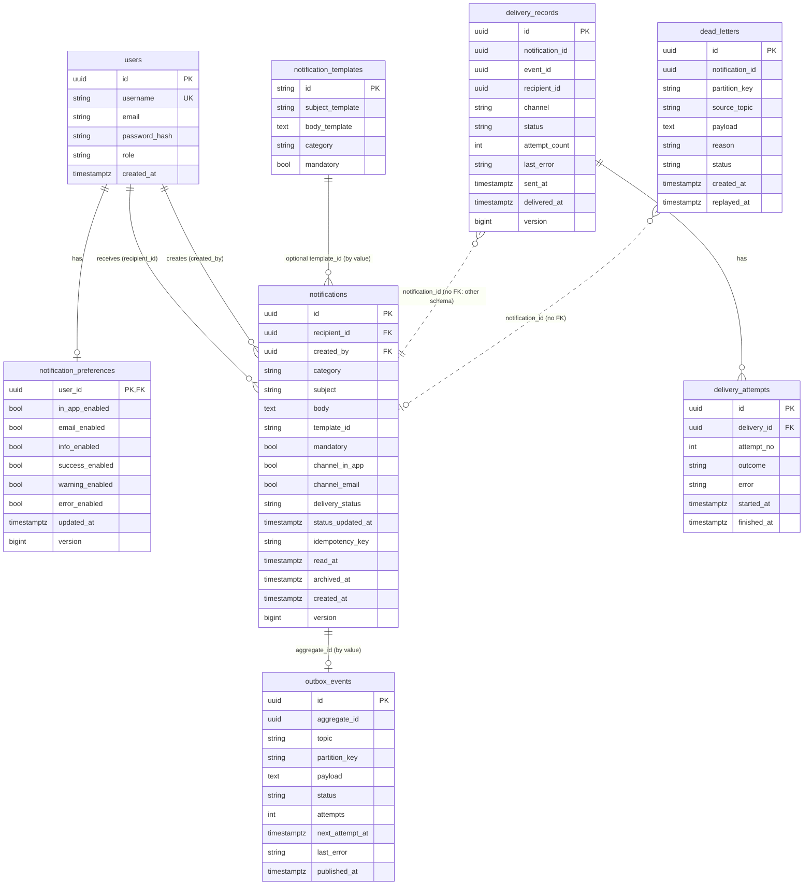

# Database design

PostgreSQL 16, one database, **two schemas** with separate login roles (`api_svc`, `worker_svc`). Flyway migrations: `notification-api-service/src/main/resources/db/migration`, `notification-worker-service/.../db/migration`. Hibernate runs with `ddl-auto: validate`.



## Entities
| Table (schema) | PK | Required / status fields | Constraints | Notes |
|---|---|---|---|---|
| users (api) | `id` uuid | username, email, password_hash (BCrypt), role, created_at | `username` unique | local identity mechanism |
| notification_preferences (api) | `user_id` (FK users, cascade) | six booleans, `version` | – | missing row = all enabled |
| notification_templates (api) | `id` varchar | subject/body templates, category, mandatory | – | seeded by `V2` |
| notifications (api) | `id` uuid | recipient, creator, category, subject, body, channel flags, `delivery_status`, `status_updated_at`, timestamps, `version` | **unique partial** `(created_by, recipient_id, idempotency_key) WHERE key IS NOT NULL` | `read_at`/`archived_at` = user state |
| outbox_events (api) | `id` uuid (= event id) | topic, partition_key, payload, `status` PENDING/PUBLISHED/FAILED, attempts, next_attempt_at | – | written in the same tx as the notification |
| delivery_records (worker) | `id` uuid | notification_id, channel, `status`, attempt_count, `version` | **unique** `(notification_id, channel)` | idempotency anchor |
| delivery_attempts (worker) | `id` uuid | delivery_id FK, attempt_no, outcome SUCCESS/FAILURE/HANDOFF, started/finished | – | full attempt history |
| dead_letters (worker) | `id` uuid | source_topic, payload, status PENDING/REPLAYED | – | notification_id null for malformed |

Idempotency records are folded into `notifications` (the unique index) instead of a separate table: the key *is* a property of the logical notification and the constraint makes the check race-free.

## Indexes
* `idx_notifications_recipient_created (recipient_id, created_at DESC, id DESC)`: serves "my notifications, newest first" and keyset pagination.
* `idx_notifications_unread (recipient_id) WHERE read_at IS NULL AND archived_at IS NULL AND channel_in_app`: tiny partial index for the badge count / unread filter (`unread-count`).
* `uq_notifications_idempotency`: duplicate prevention.
* `idx_outbox_pending (created_at) WHERE status='PENDING'`: relay scans only pending rows.
* `uq_delivery_notification_channel`, `idx_delivery_status` (partial on non-terminal states), `idx_attempts_delivery`, `idx_dead_letters_status`.

## Verify locally
```bash
docker compose exec postgres psql -U postgres -d notifications -c "\dt api.*" -c "\dt worker.*"
docker compose exec postgres psql -U postgres -d notifications -c "select status,count(*) from api.outbox_events group by 1"
```
