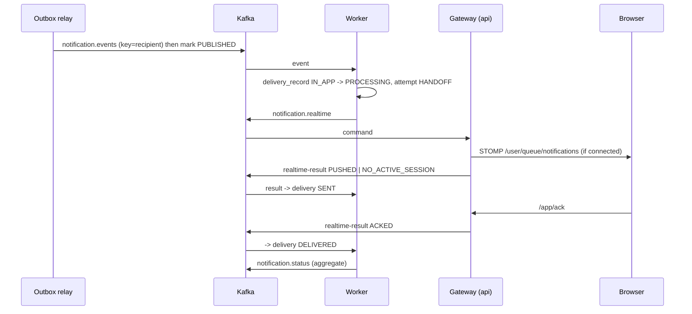
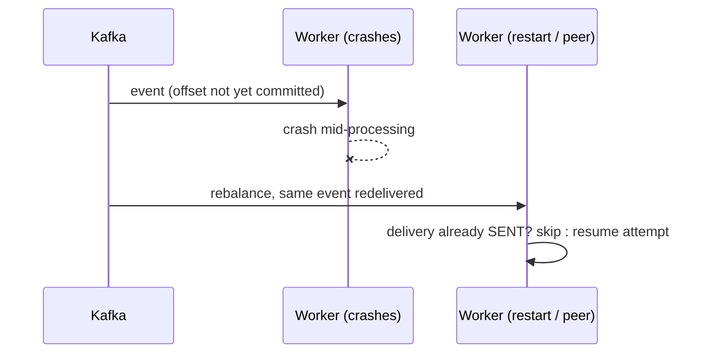

# Failure scenarios and recovery

## Sequence diagrams
**Creation (atomic with outbox)**
```mermaid
sequenceDiagram
  participant C as Client
  participant A as API
  participant DB as PostgreSQL
  C->>A: POST /notifications (JWT, Idempotency-Key)
  A->>A: validate, authorise, render template, resolve channels by preferences
  A->>DB: BEGIN; INSERT notification; INSERT outbox_event; COMMIT
  A-->>C: 201 (status PENDING)
```
**Kafka delivery + realtime**

**Retry and dead-letter**
```mermaid
sequenceDiagram
  participant K as Kafka
  participant W as Worker
  participant M as SMTP
  K->>W: notification.events
  W->>M: send (fails) ; attempt FAILURE, delivery RETRYING
  W->>K: -> events-retry-0 (backoff)
  K->>W: retry-0, fails again -> retry-1
  K->>W: last attempt fails -> events-dlt
  W->>W: DLT handler: delivery DEAD_LETTERED, dead_letters row, status event
  Note over W: admin POST /admin/dead-letters/{id}/replay republishes to notification.events
```
**Consumer crash**


## Scenario table
| Failure | Expected behaviour / state transitions | How to verify locally |
|---|---|---|
| **Kafka down** | API still accepts requests (`201`); outbox rows stay `PENDING`, `attempts` and backoff grow; WS/worker idle. On recovery they publish in order. | `docker compose stop kafka`; send notifications; `select status,attempts,last_error from api.outbox_events;`; `docker compose start kafka`; rows become `PUBLISHED`, UI updates. |
| **PostgreSQL down** | API requests fail `5xx` (nothing committed, nothing to lose); relay logs a failed cycle and retries; worker listener throws → retry topics/DLT if long outage (increase `worker.retry.*` for outages longer than the retry budget). | `docker compose stop postgres`, call API, start again, health returns UP. |
| **Worker crashes mid-event** | Offset uncommitted → redelivery; `SENT` channels are skipped; an in-flight email may be sent twice (documented residual window). | `docker compose kill notification-worker` while sending; `docker compose start notification-worker`; check MailHog and `worker.delivery_attempts`. |
| **Browser disconnects** | Gateway reports `NO_ACTIVE_SESSION` → delivery `SENT` (stored); notification stays unread in DB; UI reconnects with backoff and reloads on connect. | Close the tab, send, reopen/sign in: it is in history and the badge counts it. |
| **Email fails** | attempt `FAILURE`, delivery `RETRYING`, aggregate `RETRYING`; retries at 2s, 4s (configurable); then `DEAD_LETTERED`. In-app channel of the same notification is unaffected. | Send to user `bounce` with Email ticked (or `docker compose stop mailhog`); watch `select channel,status,attempt_count from worker.delivery_records;`. |
| **Malformed message** | Non-retryable → straight to `-dlt`; `dead_letters` row with null notification id, not replayable; partition keeps moving. | `docker compose exec kafka /opt/kafka/bin/kafka-console-producer.sh --bootstrap-server localhost:9092 --topic notification.events` then type `garbage`; `GET :8081/admin/dead-letters`. |
| **Duplicate event** | Delivery already `SENT/DELIVERED` → skipped, aggregate status re-published (idempotent). | Replay a dead letter or re-produce an event; MailHog shows one email. Covered by `duplicateKafkaEventIsProcessedOnlyOnce`. |
| **Retry limit exceeded** | After `worker.retry.attempts` total attempts (default 4) → `DEAD_LETTERED`, status event, error log without payload; admin replay available. | As "Email fails"; then `curl -H "X-Admin-Key: $KEY" localhost:8081/admin/dead-letters` and `POST …/{id}/replay` after fixing the cause. |
| **Duplicate API request** | Same `Idempotency-Key` → `200 duplicate:true`, one row. | Send twice from the dev panel with the same key. |
| **Status event arrives late** | Ignored when older than stored `status_updated_at`. | `staleStatusEventsAreIgnored` test. |

## Inspect retry/DLT topics
```bash
docker compose exec kafka /opt/kafka/bin/kafka-topics.sh --bootstrap-server localhost:9092 --list
docker compose exec kafka /opt/kafka/bin/kafka-consumer-groups.sh --bootstrap-server localhost:9092 --describe --group notification-worker   # lag
```

## Graceful shutdown
`server.shutdown=graceful`, 30 s phase timeout, `stop_grace_period: 40s`. Spring Kafka stops containers, finishing the in-flight record and committing its offset before exit.
