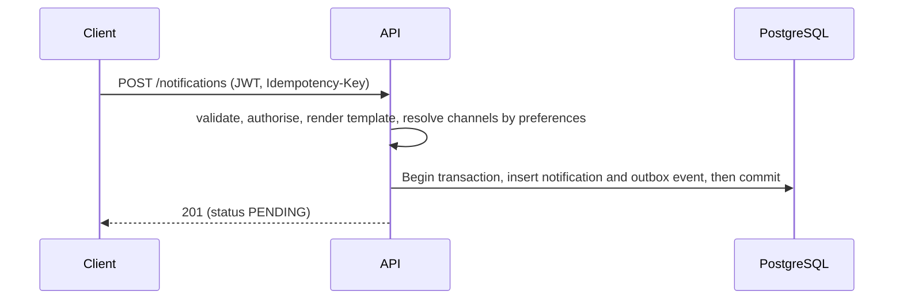
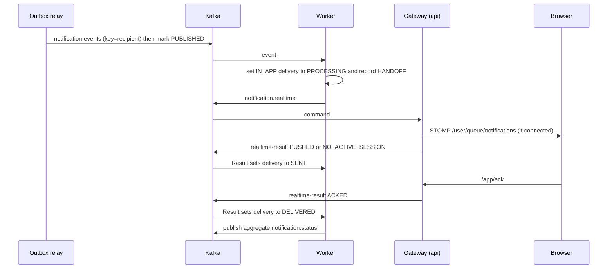
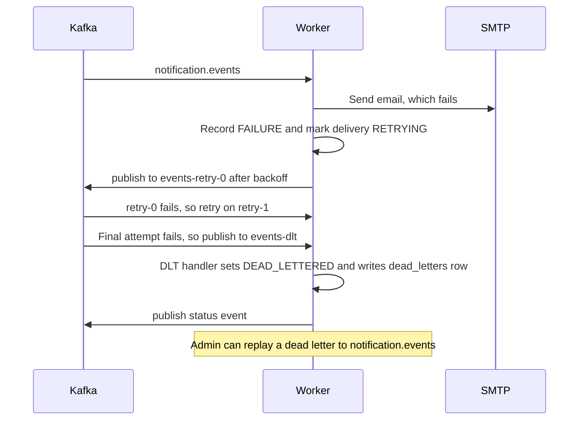
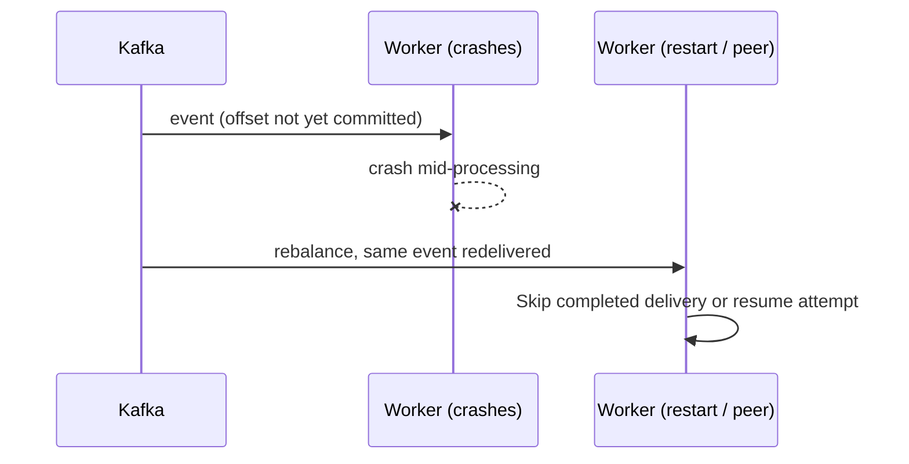

# Failure scenarios and recovery

## Sequence diagrams
### Creation (atomic with outbox)


### Kafka delivery + realtime


### Retry and dead-letter


### Consumer crash



## Scenario table
| Failure | Expected behaviour / state transitions | How to verify locally |
|---|---|---|
| **Kafka down** | API still accepts requests (`201`); outbox rows remain `PENDING` and retry with exponential backoff capped at 60s. After 50 failed publishes by default, a row becomes `FAILED` and is no longer retried automatically. Eligible rows publish in order after Kafka recovers; notifications update as workers process them. | `docker compose stop kafka`; send notifications; query `api.outbox_events` for status, attempts, and last_error; `docker compose start kafka`; verify rows that have not exhausted retries become `PUBLISHED`. |
| **PostgreSQL down** | API requests fail `5xx` (nothing committed, nothing to lose); relay logs a failed cycle and retries; worker listener throws → retry topics/DLT if long outage (increase `worker.retry.*` for outages longer than the retry budget). | `docker compose stop postgres`, call API, start again, health returns UP. |
| **Worker crashes mid-event** | Offset uncommitted → redelivery; `SENT` channels are skipped; an in-flight email may be sent twice (documented residual window). | `docker compose kill notification-worker` while sending; `docker compose start notification-worker`; check MailHog and `worker.delivery_attempts`. |
| **Browser disconnects** | Gateway reports `NO_ACTIVE_SESSION` → delivery `SENT` (stored); notification stays unread in DB; UI reconnects with backoff and reloads on connect. | Close the tab, send, reopen/sign in: it is in history and the badge counts it. |
| **Email fails** | Each failed delivery attempt is recorded as `FAILURE` and the delivery becomes `RETRYING`; retries use 2s, 4s, then 8s backoff by default. After four total attempts (one initial attempt plus three retries), the email delivery becomes `DEAD_LETTERED`. In-app delivery for the same notification is unaffected. | Send to user `bounce` with Email ticked (or `docker compose stop mailhog`); inspect `worker.delivery_records` for channel, status, and attempt_count. |
| **Malformed message** | Invalid JSON is non-retryable and goes straight to the DLT; the `dead_letters` row has a null notification id and cannot be replayed. The partition continues processing. | `docker compose exec kafka /opt/kafka/bin/kafka-console-producer.sh --bootstrap-server localhost:9092 --topic notification.events`, then type `garbage`. Configure `WORKER_ADMIN_KEY` in `.env`, set `KEY` in your shell to the same value, and query with `curl -H "X-Admin-Key: $KEY" http://localhost:8081/admin/dead-letters`. |
| **Duplicate event** | Delivery already `SENT/DELIVERED` → skipped, aggregate status re-published (idempotent). | Replay a dead letter or re-produce an event; MailHog shows one email. Covered by `duplicateKafkaEventIsProcessedOnlyOnce`. |
| **Retry limit exceeded** | After `worker.retry.attempts` total attempts (default 4) → `DEAD_LETTERED`, a status event, and an error log without the payload; admin replay is available for well-formed events. | As "Email fails"; configure `WORKER_ADMIN_KEY` in `.env`, set `KEY` in your shell to the same value and `ID` to a replayable dead-letter id, then run `curl -X POST -H "X-Admin-Key: $KEY" "http://localhost:8081/admin/dead-letters/$ID/replay"` after fixing the cause. |
| **Duplicate API request** | Same `Idempotency-Key` → `200 duplicate:true`, one row. | Send twice from the dev panel with the same key. |
| **Status event arrives late** | Ignored when older than stored `status_updated_at`. | `staleStatusEventsAreIgnored` test. |

## Inspect retry/DLT topics
```bash
docker compose exec kafka /opt/kafka/bin/kafka-topics.sh --bootstrap-server localhost:9092 --list
docker compose exec kafka /opt/kafka/bin/kafka-consumer-groups.sh --bootstrap-server localhost:9092 --describe --group notification-worker   # lag
```

## Graceful shutdown
`server.shutdown=graceful`, 30 s phase timeout, `stop_grace_period: 40s`. Spring Kafka stops containers, finishing the in-flight record and committing its offset before exit.
